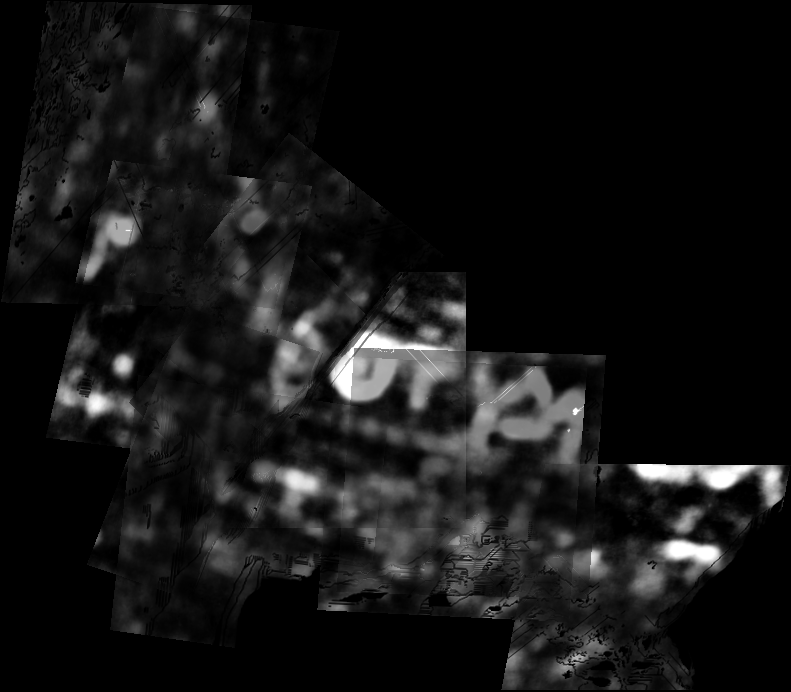

# Ink Prospector

Finds where the ink is in a rolled Herculaneum scroll before anyone unwraps it.

The usual route is to fit the whole spiral, mesh every winding, flatten, and only then look for ink. The Prospector
turns that around. It drops seeds through a region of the scan, grows a small piece of sheet from each one, reads both
faces with an ink model, and ranks the pieces. The output is a map of where text is likely, so meshing and reading
effort can go there first. It needs no spiral fit, umbilicus, normal volume or winding numbers, and it streams only the
chunks it touches from the open-data bucket.




## Quick start

With Docker (CPU image, about 4 GB):

```sh
docker build -t ink-prospector:cpu .
mkdir runs && cd runs
P="docker run --rm -v $PWD:/work ink-prospector:cpu"

$P scan --scroll PHerc0306B --box 9000 10000 2400 3400 3400 4400 --out demo      # 64 seeds, about 1 h on 4 cores
$P rank demo -n 12 --sheet demo-top12.png                                       # ranked hit list + contact sheet
$P viewer demo --out demo-site --title PHerc0306B                                # 3D map page
python3 -m http.server -d demo-site 8000                                         # open http://localhost:8000
$P spread --scroll PHerc0306B --seed 9381 3281 4275 --side a --out demo-spread   # 22 mm patch around a hit
```

For a GPU, build with `--build-arg TORCH_INDEX=https://download.pytorch.org/whl/cu124`, run with `--gpus all` and add
`--device cuda` to `scan`.

Without Docker: `bash setup.sh ~/prospector` builds the work folder (venv, pinned reader code, weights with a sha256
check, smoke test). Then run from this folder: `PROSPECTOR_HOME=~/prospector ~/prospector/venv/bin/python prospect.py ...`.
Outputs (`runs/`, contact sheets, viewer pages) are written relative to the folder you run from.

`python -m pytest -q` (in this folder; needs numpy, scipy, pillow, tifffile and pytest, no torch or network) runs the
tests: the text score and ranking, the volume reader on local zarrs, seed snapping, growth and rendering on a
synthetic tilted sheet, the tifxyz export, and the whole-scroll hit rule. They check the code, not what it finds on
real data; that is under "What has been checked" below.

To split a scan over machines, give each the same command with `--shard 0/4`, `--shard 1/4`, and so on. The seed order
is fixed, runs are resume-safe, and `rank` and `viewer` accept the run folder with its `shard-*` subfolders. Shards do not see
each other's patches, so two shards can grow the same sheet; `rank` lists both and `stitch` joins them.

## Auto mode

`prospect.py auto --scroll PHerc0306B [more scrolls] --out auto` runs the whole pipeline unattended, per scroll, into
`runs/auto-<scroll>/`: a sweep of the whole volume (lattice at `--spacing`, default 800 vx, split over `--workers` local
processes; `--box` limits it, `--sweep DIR` reuses an existing scan), the best one-sided leads by text score with their
letter score (`auto/leads.tsv`), 22 mm fused reads of the top `--spread` leads, stitched sheets (`_stitch/`), the 3D viewer
(`_viewer/`) and a VC3D hand-off of every lead and spread as tifxyz with a point collection and `grow.sh` (`auto/vc/`).
`auto/auto.json` records each stage; running the same command again skips finished stages and resumes the sweep.
`auto/REPORT.md` sums it up. In the app, "Auto: whole scroll" starts it and the run page shows the stages and leads.

## The app

`prospect.py serve --runs runs` starts a local app at http://127.0.0.1:8765 that drives the same commands from a browser:

- **Runs:** every run folder under `--runs` with its progress (as `status`), patch count, area read and best text score.
- **New run:** forms for a box scan, scoring tifxyz surfaces (VC3D segments, HerculeX sheets, `--tile`, `--crop`) and a
  spread from a seed. Shards start as parallel jobs.
- **Run page:** the ranked list (as `rank`) with both faces of every patch and a letter-likeness column (`letterscore.py`
  on the ink face of the saved maps, 4 voxels per pixel; sortable), full-size maps, the ranked TSV, a button
  that builds the 3D viewer for that run, and one that stitches the sheets of the top hits (as `stitch`) and shows them with
  their letter score. A hit's seed can be sent straight to a spread.
- **Jobs:** state and live log of every job; stop and resume. Resume runs the same command again (`--resume` for scored
  surfaces), so only missing patches are done.

Jobs run as ordinary processes and are recorded in `<runs>/.jobs/`, so they keep running, and the app shows how they
ended, if the browser or the server is closed. The app uses the Python standard library only and listens on localhost,
since it starts processes on the machine. With Docker:
`docker run -p 127.0.0.1:8765:8765 -v "$PWD/runs:/work/runs" ink-prospector:cpu serve --runs runs --host 0.0.0.0`.
Design and API: [`docs/APP.md`](docs/APP.md). Without a server behind it (as on GitHub Pages:
https://neg-0.github.io/vesuvius-research/ink-prospector/app/) the app opens read-only on the demo scan below.

## Try it without installing

**Live demo: https://neg-0.github.io/vesuvius-research/ink-prospector/demo/**, the viewer built from a blind scan of
PHerc0306B (126 patches, 77 cm2): 3D map of every patch, ranked hit list, both-face reads. The files are in [`demo/`](demo/);
to open them locally run `python3 -m http.server -d demo 8000` and open http://localhost:8000 (opening `index.html`
straight from disk does not work, because the page loads `data.json`).

## Commands

| command | what it does |
|---|---|
| `scan --scroll S --box z0 z1 y0 y1 x0 x1 --out DIR` | Seeds a lattice (`--spacing`, default 250 vx) in the box, grows a patch (`--half-nodes` 128 = 8.9 mm) on every sheet not already covered, reads both faces. |
| `rank DIR... [-n N] [--sheet PNG] [--tsv FILE [--letters]] [--min-area CM2]` | Lists patches by text score and writes a contact sheet of the best side of each. `--min-area` leaves out patches with less read surface (slivers at a sheet's edge, whose scores are noisy). `--tsv` writes every usable patch, best first (rank, id, scores, seed, tifxyz window, path of the ink-side PNG), for merging runs in a spreadsheet or script; `--letters` adds `letterscore.py` on each patch's ink face (`letter_score`, `letters`, `fails`), so you can sort or filter on letter-likeness too. |
| `spread --scroll S --seed z y x --side a\|b --out DIR` | Grows one large patch (`--half-nodes` 320 = 22 mm) from a hit and reads it at full resolution, averaging four turned and mirrored reads (the result then does not depend on how the patch happens to be turned; it does not recover more ink). `scan --fuse` does the same per patch at 4x the read time. |
| `python3 export_tifxyz.py pNNNN.npz OUT.tifxyz [--scroll S --scan ID]` | Writes one grown patch as a tifxyz surface (x.tif, y.tif, z.tif, meta.json, scale 0.25) so a hit can be opened in VC3D or used as a starting surface. Checked on 46 real PHerc0343 patches: villa's own reader (`vesuvius.tifxyz.read_tifxyz`) gives back the exact coordinates and valid mask, and the files are float32 single-band TIFFs with -1 for untracked nodes, the layout VC3D's C++ loader reads. Not yet opened in the VC3D GUI. |
| `python3 score_tifxyz.py --scroll S --out DIR SEG... [--crop r0 r1 c0 c1] [--tile N] [--max-cache-gb G] [--resume] [--shard i/n] [--limit N]` | Reads and scores surfaces that already exist: any tifxyz segment (VC3D segments, segments grown with `grow.sh`, community or whole-scroll sheets). Writes a scan folder, so `rank`, `viewer`, `stitch` and `vc_export.py` work on it. Checked: a Prospector patch exported to tifxyz and read back gives the same ink map as the scan (r = 0.9999, bright share 0.0381 vs 0.0382). At VC's 20-voxel grid (`--every 5`) the surface between nodes is interpolated and the reads come out weaker (0.030 vs 0.038 on that patch). `--tile N` cuts each surface into N x N-node tiles and scores each one as its own patch, so a whole-scroll sheet is ranked tile by tile with bounded memory; `surfaces.tsv` records each tile's grid window. `--max-cache-gb G` (also on `scan.py`) caps the CT chunks held in memory, dropping the least recently used; the render is byte-identical. Uncompressed tifxyz grids (HerculeX sheets, VC output) are memory-mapped, so each tile reads only its own rows: planning the tiles of a 1500 x 30000-node test sheet and loading 20 of them took 0.70 GB peak and 0.3 s, against 1.17 GB and 1.0 s when the whole grid was read. `--resume` keeps the patches an earlier run into the same `--out` already scored and scores only the rest, so a long whole-sheet run survives a restart (it refuses a folder made from other surfaces or tiles). `--limit N` scores at most N patches and stops cleanly, so a long sheet can be run in fixed-size chunks (for example on machines with a time cap): repeat the same command with `--resume --limit N` until it prints `done`. Each patch's log line ends with how many of this run's patches are done and the time left at the mean pace so far. A tile with no CT data under it (off the scan, or on chunks the scan does not have) is recorded as `noct` without a reader pass. A patch that throws (a failed chunk fetch, a corrupt grid) is logged and skipped rather than ending the run; the run then exits non-zero naming the failed ids, and `--resume` retries only those. `--shard i/n` scores only the patches whose id mod n is i, so n machines can split one sheet, each writing its own `--out`; ids stay global, and `rank`, `stitch` and `viewer` take all the shard folders at once. `prospect.py status DIR...` shows what each shard folder has left, how many of its rows were read (`ok`) or skipped (`noct`, `small`) and which patch ids no folder has (a shard that was never started or got cut off); it exits 1 while anything is missing, so a script can wait on it. On a 2 x 2 cm window of PHerc1545 (4 CPUs, one run each) a 1 GB cap cut peak memory from 4.63 to 2.66 GB, with the same time (81 vs 84 s) and 2% more download. |
| `python3 letterscore.py --dirs DIR... [--um U]` or `letterscore.py INK.npy BACK.npy [VALID.npy] --um U` | Scores how letter-like an ink map is: confident strokes are grouped into forms, a form counts if it is 2-5 mm, not a bar, not a filled blob and drawn in thin strokes, and the score is the longest row of such forms on one line times the share of ink they hold times (1 - back face / ink face) times (1 - halo). The halo is the share of a 0.3 mm ring around each row form where ink is above 0.4: strokes on clean papyrus have little, while haze that the threshold cuts into letter-sized pieces sits in half-confident ink. `letters` is the pass rule: at least 4 forms in a row, at least 35% of the ink in letter-like forms, back face under a third, halo at most 0.5; `fails` names the rules a map missed (`row`, `forms`, `two-sided`, `halo`, or `-` when it passes). `--dirs` ranks folders holding `prob_v3_fwd.npy`, `prob_v3_rev.npy`, `valid.npy` and `followup.json`; a folder that cannot be read is skipped with a note, the rest are still ranked, and the command exits non-zero naming the skipped ones. Folders are named by their last path part, with more parts added when two would print the same (`a/w084`, `b/w084`). It is strict: letters blurred together into one word-sized form are not counted, so a fail does not rule text out; use it to rank and to flag strong rows for a look by eye. The defaults (stroke width up to 1.2 mm, ink filling up to 70% of a form's box) were set on hand-judged follow-up maps at about 37 um per pixel; other pixel sizes may need `--max-stroke-mm` and `--max-fill` checked. |
| `stitch DIR... --out OUT [--top N]` | Joins patches that lie on the same sheet into one flat map per sheet (`sheetK_ink.png`, `sheetK_back.png`, `sheets.json`), for the sheets holding the top N hits. |
| `serve [--runs DIR] [--port 8765] [--host H]` | Starts the app (see "The app" above). |
| `viewer DIR... --out SITE [--known x.tif y.tif z.tif r0 r1 c0 c1 label] [--full N] [--min-area CM2]` | Builds a self-contained page: 3D map of all patches, hit list, both-side reads. `--min-area` leaves out edge slivers, as in `rank` (also on `vc_export.py`). `--known` overlays a surface with known text. The detail panel links the full-size ink maps of the N best patches (`--full`, default 50, 0 for none), since the page itself holds 256 px thumbnails; for tifxyz runs it also names each tile's grid window. |

Scrolls are named in `scrolls.json` (CT volume, surface prediction, voxel size). Add an entry, or pass `--ct`, `--m7`
and `--um`. Coordinates are level-0 voxels, z y x.

## Taking hits into Volume Cartographer (VC3D)

VC3D, the Volume Cartographer GUI in [ScrollPrize/villa](https://github.com/ScrollPrize/villa/tree/main/volume-cartographer),
is where segments are traced, edited and rendered. `vc_export.py` hands the best hits to it:

```sh
python3 vc_export.py vc-hits runs/demo -n 10        # top 10 patches by text score
cd vc-hits && ./grow.sh                             # needs VC's tools (e.g. ghcr.io/scrollprize/villa/volume-cartographer:edge)
```

- `paths/prospector_<id>/`: each hit as a tifxyz surface at every 5th node, a 20-voxel grid, which is the step VC's
  tracer uses. `meta.json` carries the rank, text score and inked face.
- `prospector_hits.json`: a VC3D point collection with one point per hit (x y z on the sheet, at the patch centre),
  to jump to each hit in the viewer.
- `grow.sh`: `vc_grow_seg_from_seed --resume` on each hit, on the scroll's surface prediction. VC's tracer then grows
  the Prospector patch into a larger segment (`grown/prospector_<id>_grown/`) that VC3D opens and `vc_render_tifxyz`
  renders. `generations` in `params.json` is the total generation count to stop at.
- `hits.tsv`: the same list as a table.

`examples/vc-306b/` is this output for three patches of a short PHerc0306B scan. The `ink-prospector VC round trip`
GitHub Actions workflow runs `grow.sh`'s commands and `vc_render_tifxyz` on it inside the published VC image.

## Formats

- **In:** OME-Zarr v2 uint8 volumes, read chunk by chunk with no full download. `--ct` and `--m7` take a path in the
  Vesuvius Challenge open-data bucket (as in `scrolls.json`), a full http(s) URL of a zarr, or a local zarr folder.
  `--m7` is a surface prediction on the same voxel grid as the CT (the public m7 surface predictions are). Missing
  chunks read as zero; a network error that persists after five retries stops the run rather than reading as empty CT, and a remote chunk that arrives cut off (it does not decode) is fetched again up to three times before the run stops with its URL.
- **Out:** tifxyz surfaces (`export_tifxyz.py`, the format VC3D and villa's `vesuvius.tifxyz` read), node grids as
  `.npz`, ink maps as 8-bit PNG (ink score 0.25 or less and no data are 0, 0.5 is 128, 0.75 or more is 255), and
  `scores.tsv` / `sheets.json` tables.

## Output of a scan

- `scores.tsv`: one row per seed. `status` is `ok`, `no_sheet` (no surface near the seed), `covered` (sheet already
  scanned), `small` (under 15% tracked) or `masked` (sheet in masked CT). `frac_a`/`frac_b` are the share of pixels
  above 0.5 on each face, `p995_a`/`p995_b` the 99.5th percentile of the read, `stroke_a`/`stroke_b` the share of thin
  bright strokes (used by `judge_whole.py`), and `secs` the time per patch.
- `pNNNN.npz`: `P` (grid of 3D nodes, z y x, 4 vx apart), `ok` (tracked nodes), `n0` (sheet normal at the seed).
- `pNNNN_a.png`, `pNNNN_b.png`: the ink read on each face at quarter resolution. Face a is read along `+n0`.
- `run.json`: the scroll, box and settings.

## How it works

1. **Seed** (`grow.seed_frame`). Snap the seed to the nearest sheet in the public surface prediction (m7) and fit a
   local frame by PCA.
2. **Grow** (`grow.grow`). Spread a grid of nodes outward in waves. Each new node is extrapolated from tracked
   neighbours and snapped along the local normal to the sheet ridge. Where the sheet is lost the node stays empty.
3. **Render** (`grow.render_fast`). Sample 17 CT layers along each node's own normal.
4. **Read** (`reader.py`). Reader V3 (koine_machines, ScrollPrize/villa `merge-ink-pipelines` at 47a9c37f; weights
   sha256 ea405417…984d8a, loaded with `weights_only=True`), once in each layer order.
5. **Score** (`textscore.py`). Ink sits on one face of a sheet. The score counts confident ink (above 0.62) in
   structures 0.3 to 6 mm across, away from the patch edge, on one face minus the other.

## What has been checked

On PHerc0306B, the scroll whose First Letters text was awarded in November 2026:

- **Geometry.** A patch grown from one seed sits a median 1.9 voxels from the winners' hand-finished mesh (91% of
  nodes within 6).
- **Same letters.** The read on the mesh-free patch correlates 0.90 with the read on the winners' mesh. Wrong-face
  controls: −0.10 and 0.04.
- **Found blind.** In a 64-seed scan of an 8.6 mm cube with no pointing, the patch on the prize sheet ranked first of
  51 by one-sided brightness. Over 177 patches from that scan and a wider one it ranks first by the text score.

On PHerc0343, the scroll whose First Letters were awarded in October 2026, with the default settings and no pointing:

- **Found blind.** In two 8.6 mm boxes around the awarded letters, the best patch on the awarded sheet ranked 2nd of 43
  and 2nd of 46 by the text score. A patch counts as on the sheet when at least half of it lies within 8 voxels of the
  winner's published mesh (Nieuwlaar, `pherc343-first-letters`); the rule was set before the runs.

## Screening a whole scroll or a dense box

Two shell runners wrap `scan` for long jobs, one shard per call, resume-safe, and print `ALL_SEEDS_DONE` when finished
(set `MAXP` to cap new patches per call and loop the same line). Run `bash setup.sh <workdir>` first.

```sh
bash run_whole.sh <workdir> <scroll in scrolls.json> 0/4 [spacing=800]          # sparse lattice through the whole volume
bash run_box.sh <workdir> <scroll> <tag> 0/4 <spacing> z0 z1 y0 y1 x0 x1        # dense pass over one box
python3 judge_whole.py <workdir>/data/runs/whole-<scroll>                       # HIT / NOTHING by the rule below
python3 sheet_whole.py <run dir> 24 top24.png                                   # contact sheet of the best candidates
```

The rule for a candidate: at least 2% confident one-sided ink (the `stroke_a`/`stroke_b` columns) with the other face
under a third of that. A whole scroll at 800 vx spacing is hundreds of patches at about 100 s each, so split it over
machines with `--shard`. The scroll must have an entry in `scrolls.json`.

## Limits

- **A hit is a place to look, not a reading.** The reader responds to strokes and to some dense papyrus. On scrolls
  where current 9 µm readers are weak, hits are ink-like blobs and single strokes, not rows of letters.
- `spread` logs an experimental line-banding number (how strongly confident ink lines up in parallel bands). On
  306B maps with text it is 2.1 to 2.7, on back faces and stroke-only sheets 1.1 to 1.9; too few samples to rely on.
  It failed a second check: at three places on the awarded PHerc0343 line it gave 1.3 to 1.9 on both faces (ragged
  sheet, one sparse line of letters). Treat it as a curiosity, not a detector.
- The text score still rewards a strong isolated stroke as much as a row of letters. A count of blobs lined up in
  rows was tried and dropped: at this resolution touching letters merge and faint mottling lines up by chance.
- `stitch` joins overlapping patches of one sheet (on 306B: 11 patches into a 24 x 27 mm map with the prize line
  running across patch borders), but only where patches overlap. There is no winding order, so this does not replace
  unwrapping for reading a whole column.
- Grid spacing drifts from 4.0 to about 4.3 voxels far from the seed, and seams appear where wavefronts meet.
- It depends on the public surface prediction. Where that is blobby (crushed regions), patches track poorly.
- Speed: about 100 s per patch on 4 CPU cores. A sparse pass over a whole scroll is about 4,500 patches.
- The default 250 vx lattice can miss a sheet. Shifting the 306B demo box by 75 vx on every axis left no patch on the
  prize sheet at spacing 250 (three settings tried). At `--spacing 150 --half-nodes 48` a patch landed on it in both
  boxes, for less CPU (about 8 s per patch), but the best one ranked lower (6th of 211 and 9th of 228, against 3rd of 51
  for the default in the unshifted box). No setting tried beat the defaults in both boxes, so they are unchanged.

## Files

`prospect.py` (command line), `scan.py`, `spread.py`, `stitch.py`, `grow.py`, `lazyvol.py`, `reader.py`, `textscore.py`, `runs.py`,
`export_tifxyz.py`, `run_whole.sh`, `run_box.sh`, `judge_whole.py`, `sheet_whole.py`, `build_viewer.py`, `viewer/index.html`, `scrolls.json`, `setup.sh`, `Dockerfile`;
`vc_export.py`, `score_tifxyz.py`, `letterscore.py`; the app `server.py`, `jobs.py`, `app/index.html`; auto mode `auto.py`; tests `test_smoke.py`, `test_pipeline.py` and `test_app.py`; `examples/vc-306b/` (VC hand-off example); `demo/` (a built viewer page) and `docs/` (the README figures).

The Prospector's own code is MIT licensed (`LICENSE`). Third-party pieces keep their own terms: Reader V3 weights (Hugging Face `domenicor046/reader-v3`), villa code, and
the scan data (Vesuvius Challenge open data).
