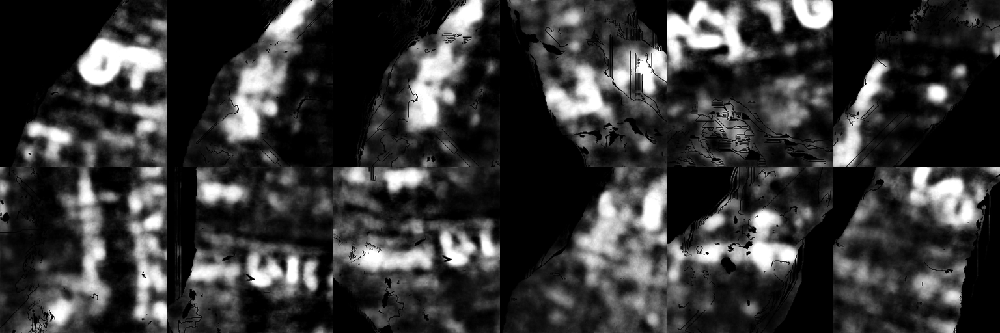

# Ink Prospector

Finds where the ink is in a rolled Herculaneum scroll before anyone unwraps it.

The usual route is to fit the whole spiral, mesh every winding, flatten, and only then look for ink. The Prospector
turns that around. It drops seeds through a region of the scan, grows a small piece of sheet from each one, reads both
faces with an ink model, and ranks the pieces. The output is a map of where text is likely, so meshing and reading
effort can go there first. It needs no spiral fit, umbilicus, normal volume or winding numbers, and it streams only the
chunks it touches from the open-data bucket.




## Quick start

With Docker (CPU image, about 4 GB):

```sh
docker build -t ink-prospector:cpu .
mkdir runs && cd runs
P="docker run --rm -v $PWD:/work ink-prospector:cpu"

$P scan --scroll PHerc0306B --box 9000 10000 2400 3400 3400 4400 --out demo      # 64 seeds, about 1 h on 4 cores
$P rank demo -n 12 --sheet demo-top12.png                                       # ranked hit list + contact sheet
$P viewer demo --out demo-site --title PHerc0306B                                # 3D map page
python3 -m http.server -d demo-site 8000                                         # open http://localhost:8000
$P spread --scroll PHerc0306B --seed 9381 3281 4275 --side a --out demo-spread   # 28 mm patch around a hit
```

For a GPU, build with `--build-arg TORCH_INDEX=https://download.pytorch.org/whl/cu124`, run with `--gpus all` and add
`--device cuda` to `scan`.

Without Docker: `bash setup.sh ~/prospector` builds the same work folder (venv, pinned reader code, weights with a
sha256 check, smoke test), then `PROSPECTOR_HOME=~/prospector ~/prospector/venv/bin/python prospect.py ...`.

To split a scan over machines, give each the same command with `--shard 0/4`, `--shard 1/4`, and so on. The seed order
is fixed, runs are resume-safe, and `rank` and `viewer` accept the run folder with its `shard-*` subfolders.

## Try it without installing

`demo/` is the viewer built from a blind scan of PHerc0306B (126 patches, 77 cm2). With GitHub Pages on, it is at https://neg-0.github.io/vesuvius-research/ink-prospector/demo/. Locally: `python3 -m http.server -d demo 8000`.

## Commands

| command | what it does |
|---|---|
| `scan --scroll S --box z0 z1 y0 y1 x0 x1 --out DIR` | Seeds a lattice (`--spacing`, default 250 vx) in the box, grows a patch (`--half-nodes` 128 = 8.9 mm) on every sheet not already covered, reads both faces. |
| `rank DIR... [-n N] [--sheet PNG]` | Lists patches by text score and writes a contact sheet of the best side of each. |
| `spread --scroll S --seed z y x --side a\|b --out DIR` | Grows one large patch (`--half-nodes` 320 = 22 mm) from a hit and reads it at full resolution, averaging four turned and mirrored reads (the result then does not depend on how the patch happens to be turned; it does not recover more ink). `scan --fuse` does the same per patch at 4x the read time. |
| `stitch DIR... --out OUT [--top N]` | Joins patches that lie on the same sheet into one flat map per sheet (`sheetK_ink.png`, `sheetK_back.png`, `sheets.json`), for the sheets holding the top N hits. |
| `viewer DIR... --out SITE [--known x.tif y.tif z.tif r0 r1 c0 c1 label]` | Builds a self-contained page: 3D map of all patches, hit list, both-side reads. `--known` overlays a surface with known text. |

Scrolls are named in `scrolls.json` (CT volume, surface prediction, voxel size). Add an entry, or pass `--ct`, `--m7`
and `--um`. Coordinates are level-0 voxels, z y x.

## Output of a scan

- `scores.tsv`: one row per seed. `status` is `ok`, `no_sheet` (no surface near the seed), `covered` (sheet already
  scanned), `small` (under 15% tracked) or `masked` (sheet in masked CT). `frac_a`/`frac_b` are the share of pixels
  above 0.5 on each face.
- `pNNNN.npz`: `P` (grid of 3D nodes, z y x, 4 vx apart), `ok` (tracked nodes), `n0` (sheet normal at the seed).
- `pNNNN_a.png`, `pNNNN_b.png`: the ink read on each face at quarter resolution. Face a is read along `+n0`.
- `run.json`: the scroll, box and settings.

## How it works

1. **Seed** (`grow.seed_frame`). Snap the seed to the nearest sheet in the public surface prediction (m7) and fit a
   local frame by PCA.
2. **Grow** (`grow.grow`). Spread a grid of nodes outward in waves. Each new node is extrapolated from tracked
   neighbours and snapped along the local normal to the sheet ridge. Where the sheet is lost the node stays empty.
3. **Render** (`grow.render_fast`). Sample 17 CT layers along each node's own normal.
4. **Read** (`reader.py`). Reader V3 (koine_machines, ScrollPrize/villa `merge-ink-pipelines` at 47a9c37f; weights
   sha256 ea405417…984d8a, loaded with `weights_only=True`), once in each layer order.
5. **Score** (`textscore.py`). Ink sits on one face of a sheet. The score counts confident ink (above 0.62) in
   structures 0.3 to 6 mm across, away from the patch edge, on one face minus the other.

## What has been checked

On PHerc0306B, the scroll whose First Letters text was awarded in November 2026:

- **Geometry.** A patch grown from one seed sits a median 1.9 voxels from the winners' hand-finished mesh (91% of
  nodes within 6).
- **Same letters.** The read on the mesh-free patch correlates 0.90 with the read on the winners' mesh. Wrong-face
  controls: −0.10 and 0.04.
- **Found blind.** In a 64-seed scan of an 8.6 mm cube with no pointing, the patch on the prize sheet ranked first of
  51 by one-sided brightness. Over 177 patches from that scan and a wider one it ranks first by the text score.

## Screening a whole scroll or a dense box

Two shell runners wrap `scan` for long jobs, one shard per call, resume-safe, and print `ALL_SEEDS_DONE` when finished
(set `MAXP` to cap new patches per call and loop the same line). Run `bash setup.sh <workdir>` first.

```sh
bash run_whole.sh <workdir> <scroll in scrolls.json> 0/4 [spacing=800]          # sparse lattice through the whole volume
bash run_box.sh <workdir> <scroll> <tag> 0/4 <spacing> z0 z1 y0 y1 x0 x1        # dense pass over one box
python3 judge_whole.py <workdir>/data/runs/whole-<scroll>                       # HIT / NOTHING by the rule below
python3 sheet_whole.py <run dir> 24 top24.png                                   # contact sheet of the best candidates
```

The rule for a candidate: at least 2% confident one-sided ink (the `stroke_a`/`stroke_b` columns) with the other face
under a third of that. A whole scroll at 800 vx spacing is hundreds of patches at about 100 s each, so split it over
machines with `--shard`. The scroll must have an entry in `scrolls.json`.

## Limits

- **A hit is a place to look, not a reading.** The reader responds to strokes and to some dense papyrus. On scrolls
  where current 9 µm readers are weak, hits are ink-like blobs and single strokes, not rows of letters.
- `spread` logs an experimental line-banding number (how strongly confident ink lines up in parallel bands). On
  306B maps with text it is 2.1 to 2.7, on back faces and stroke-only sheets 1.1 to 1.9; too few samples to rely on.
  It failed a second check: at three places on the awarded PHerc0343 line it gave 1.3 to 1.9 on both faces (ragged
  sheet, one sparse line of letters). Treat it as a curiosity, not a detector.
- The text score still rewards a strong isolated stroke as much as a row of letters. A count of blobs lined up in
  rows was tried and dropped: at this resolution touching letters merge and faint mottling lines up by chance.
- `stitch` joins overlapping patches of one sheet (on 306B: 11 patches into a 24 x 27 mm map with the prize line
  running across patch borders), but only where patches overlap. There is no winding order, so this does not replace
  unwrapping for reading a whole column.
- Grid spacing drifts from 4.0 to about 4.3 voxels far from the seed, and seams appear where wavefronts meet.
- It depends on the public surface prediction. Where that is blobby (crushed regions), patches track poorly.
- Speed: about 100 s per patch on 4 CPU cores. A sparse pass over a whole scroll is about 4,500 patches.

## Files

`prospect.py` (command line), `scan.py`, `spread.py`, `stitch.py`, `grow.py`, `lazyvol.py`, `reader.py`, `textscore.py`, `runs.py`,
`run_whole.sh`, `run_box.sh`, `judge_whole.py`, `sheet_whole.py`, `build_viewer.py`, `viewer/index.html`, `scrolls.json`, `setup.sh`, `Dockerfile`.

The Prospector's own code is MIT licensed (`LICENSE`). Third-party pieces keep their own terms: Reader V3 weights (Hugging Face `domenicor046/reader-v3`), villa code, and
the scan data (Vesuvius Challenge open data).
