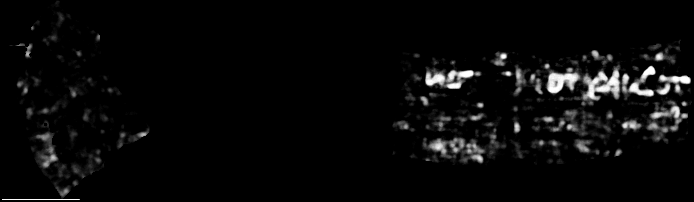

# End-to-end known-text control on PHerc0306B: an open pipeline reproduces the prize text once the band is right

The PHerc0306B First Letters text was found and claimed by **Warner and Bodill**, who won the 2nd First Letters prize
in November 2026. Their release, including the claim mesh and method, is
[SirProdigle/pherc0306b-first-letters @ 3f60827](https://github.com/SirProdigle/pherc0306b-first-letters/tree/3f60827).
This folder does not copy their mesh, which is CC BY-NC 4.0. Download it from their repo.

We use their result as a **known-text control** for an independent pipeline. The pipeline is our own m7-derived
normals, a hand-placed umbilicus, the unmodified villa spiral-fit → snap → lasagna flatten chain, and Reader V3 off
the shelf. The question is whether this pipeline reads the published text when it is meshed and read independently.

## Result

The pipeline **reproduces their find**. One of our windings, w069, lies on their claim surface: median distance
3.13 voxels, with 91% of claim-box points within 10 voxels. On w069, Reader V3 shows the letter row at the published
place in the forward direction.

| winding | median / p90 distance to claim mesh (vx) | fraction within 10 vx | sheet P | V3 forward | V3 reverse |
| --- | --- | --- | --- | --- | --- |
| w067 | 24.35 / 37.87 | 0.001 | 0.926 | no letters (streaks) | no letters |
| w068 | 22.69 / 32.87 | 0.073 | 0.939 | no letters (streaks, blobs) | no letters |
| **w069** | **3.13 / 7.92** | **0.913** | 0.856 | **letter row at the published place** | no letters |
| w070 | 21.46 / 30.67 | 0.079 | 0.738 | faint stroke fragments, same place | no letters |
| w071 | 36.49 / 51.53 | 0.010 | 0.844 | no letters (blobs) | no letters |

- Distances come from `near.py` (`data/near.tsv`). Taking the union of all scored windings gives a median of 3.06 vx,
  with 98.3% of points within 10 vx.
- Sheet P is the on-sheet fraction of a simple papyrus/off-sheet gate. A labelled control scores 0.997.
- The marks are visual reads beside the winners' published image. The reverse map is in `figures/w069_v3_rev.png`.

## What we learned (generic, applies to any scroll)

1. **Band choice matters more than the reader.** An earlier mesh of ours on this scroll sat at mid-height
   (z 7199-8699), entirely below the text (z 8966-10304). It read nothing there. The text sits in the scan's
   best-quality bin according to the public
   [Scan-Quality-Map atlas](https://github.com/jcooperkai-sys/Scan-Quality-Map) (@ `76fcf8ed`, `docs/atlas.json`),
   which is also how the winners chose their band.
2. **Our own band score did not pick the text band (negative result).** `bandq.py` scores structure-tensor coherence,
   fraction of non-sheet voxels and crest regularity per 768-slice bin of the public m7 prediction. On 0306B,
   coherence is 0.88-0.93 everywhere from z 6144 to 10752 (`data/bandq_0306B.txt`), so the text bin (9216) does not
   stand out. The SQM atlas does single it out. We use the atlas for band choice.
3. **Winding indices drift across physical sheets, so read every snapped winding.** Below the text, the winners'
   sheet lies on our earlier mesh only as a union of three neighbouring winding indices (15-25% each within 10 vx).
   At the text band, most of the text is on one winding (w069) and a fainter part on its neighbour. A screen that
   samples every 4th winding would likely have missed it.
4. **Read both depth directions, and don't pick one by a statistic.** On w069 the letters are in the forward map.
   A separation score, S = (p99.5 − p50)/IQR, would have picked reverse (`data/separation.tsv`).

## Method

- **CT:** `PHerc0306B/volumes/20250521133212-8.640um-1.2m-116keV-masked.zarr` (8.64 µm, 116 keV), public bucket
  `vesuvius-challenge-open-data`.
- **Surface prediction:**
  `PHerc0306B/representations/predictions/surfaces/20250521133212-surface-20260413222639-surface-m7-L0-th0.2.zarr`.
- **Normals:** our `make_normals.py`, from the m7 prediction alone, at level 2 z 2144-2656. It is published separately
  in [lasagna-normals-from-m7](../lasagna-normals-from-m7/). The scroll has no published lasagna normals.
- **Umbilicus:** hand-placed on m7 level-2 slices, `data/PHerc0306B_umbilicus.json`, sha256
  `b0793be58db1dc23a2c9fcb57d0f9c050062dac7b50cc4dbc60908106e406fe5`. Its top control point is z 8900, so above that
  villa's linear extrapolation is used. The text is about 1885 vx from the axis.
- **Band:** z 8900-10400. Tracks were extracted on the band, and the SDT z-range is 8836-10464.
- **Fit:** villa `fit_spiral.py` (villa @ `0fb38c45`), sense **ACW**, 14,000 steps, then `snap_meshes.py` defaults
  (120 windings).
- **Winding choice:** `near.py SNAP_DIR WINNERS_TIFXYZ OUT_TSV` against the winners' claim mesh (box rows 82:138, cols
  122:342). Self-test: `python near.py selftest`.
- **Flatten:** villa `lasagna/fit.py configs/flatten_fast_nofilter.json`.
- **Render:** `vc_render_tifxyz --num-slices 28 --slice-step 1 --scale 1`, cropped to the claim box plus 2 mm.
- **Reader:** Reader V3, HF `domenicor046/reader-v3` @ `39f626e595304c35c6ef574ffc0b6cc1e0ed44cb`, checkpoint sha256
  `ea405417450abd8ace1b8ff79ebce3adb646c5e48ab95da46844d77efe984d8a`, loaded with `weights_only=True`. Inference used
  villa @ `0fb38c45` with `--overlap 0.5 --blend-mode hann --direction both --layer-start 6 --layer-end 23`.
- **Band score:** `python bandq.py M7_ZARR UMBILICUS_JSON Z0 Z1`.

## Caveats

- **The sense was set by hand.** The automatic near-tie rule (lower median snap offset) picked CW by 1.0%. We
  overrode it to ACW to match our earlier mesh of this scroll and the winners' fit. CW was never read, so we cannot
  say whether the wrong sense would also have read. Scroll sense is physical. We now reuse a scroll's established
  sense rather than trust a near-tie pick.
- The fit ran 14,000 steps, fewer than the 20,000 of our earlier band. That was enough here.
- This is one scroll and one text region. It shows the pipeline can read at 8.64 µm when the band is right. It does
  not say how often the band is the only problem.
- Winding choice used the winners' mesh, which a blind search does not have. Without it, read every snapped winding
  (point 3).

## Licences

Code in this folder: the repository's licence. The figures are Reader V3 outputs on the public PHerc0306B
CT, under the scan data's licence. The winners' mesh and text are theirs, under their release's licence.
